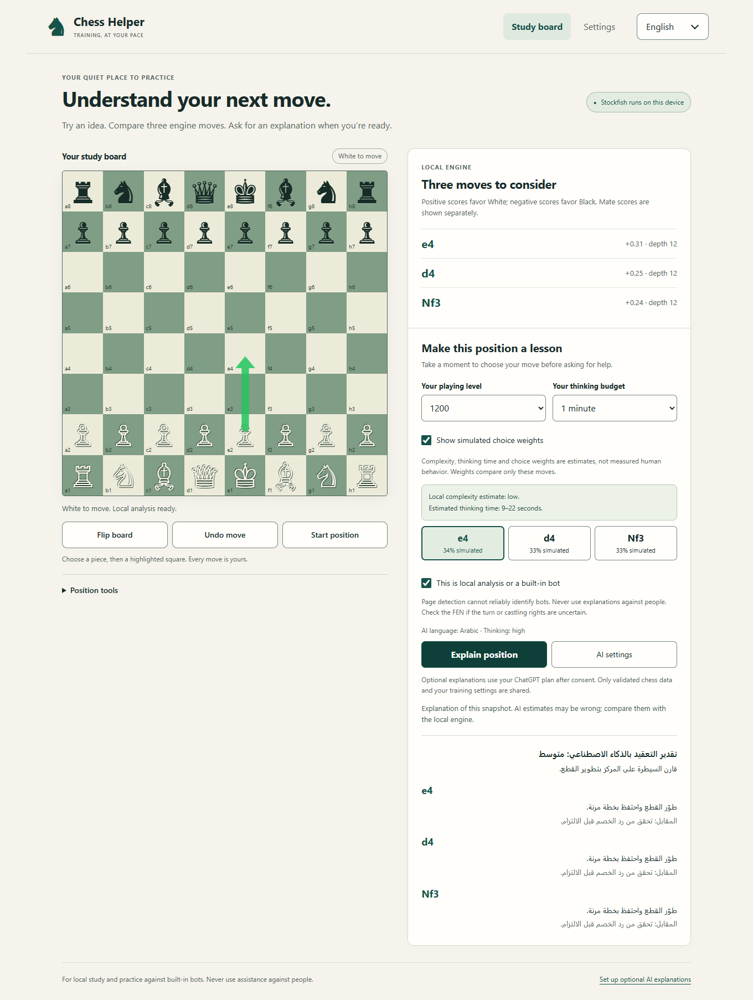

# Chess Helper Training

Learn why a chess move works. Analyze positions locally with Stockfish, compare up to three moves, and optionally ask for a short explanation using your ChatGPT plan.

**[العربية — دليل البدء](docs/AR.md)** · [Windows setup](WINDOWS-SETUP.md) · [Set up with an AI agent](docs/AI-AGENT-SETUP.md) · [Privacy](PRIVACY.md) · [Test results](TEST-RESULTS.md)

Repository: [zackmsa777-a11y/chess-helper-training](https://github.com/zackmsa777-a11y/chess-helper-training).

Use this tool for **local study, analysis and practice against built-in bots**. Do not use it against people. The page detector cannot reliably establish whether an opponent is a bot.



*Local study screenshot with synthetic test data; no real account or live game is shown.*

## Start with local analysis

You do not need an account, an API key or the companion app for local analysis.

1. Choose **Code → Download ZIP** on this repository, then extract it to a permanent folder. If you already cloned it, use that checkout. The repository includes the built extension.
2. In Chrome, open `chrome://extensions`, enable **Developer mode**, click **Load unpacked**, and select the extracted **`extension`** folder. Select that folder, not the ZIP or the repository root.
3. Open the extension's **Details → Extension options**, then click **Open study board**. Make moves yourself or import a FEN position. Stockfish starts locally.

Chrome or Edge **120+** is required. The optional account companion currently requires **Windows 10/11 and Node.js 22.15+**. Full instructions, including what to do after an update, are in [Windows setup](WINDOWS-SETUP.md).

## What you can do

- **Compare moves:** see up to three legal engine candidates, their scores and depth. Select one to show a single board arrow.
- **Practice at your level:** choose a player rating and a thinking budget. See estimated complexity and thinking time; optionally show simulated move-choice weights.
- **Ask why:** click **Explain position** for concise ideas, candidate tradeoffs and possible replies drawn from the supplied engine lines.
- **Choose your language:** use the study board, settings and floating website panel in English or Arabic, including right-to-left layout. Choose the AI explanation language separately.
- **Choose model thinking:** keep the model's default or select a reasoning effort actually supported by the account's selected model. Unavailable choices are not offered.
- **Stay in control:** move pieces manually, flip the board, undo or import a position. No autoplay is added.

Stockfish scores are **from White's perspective**: positive favors White, negative favors Black. Mate scores are separate from pawn scores. Complexity, estimated thinking time and simulated weights are **estimates, not measured human behavior**. Weights compare only the displayed candidates.

The floating website panel uses the same readable paper-and-green interface as local study. Its direction follows your selected language, independently of the website, while chess notation and scores stay left-to-right. The donation button and its bundled images have been removed; original authorship and licenses remain.

[Preview the English panel](docs/images/panel-en.png) · [معاينة اللوحة العربية](docs/images/panel-ar.png). These previews use a synthetic board, not a live game.

The original extension's unrelated engine controls, accuracy tracking, page adapters and translations are retained. Its older guide is preserved in [the upstream guide](docs/UPSTREAM-GUIDE.md); current setup and training behavior are described here.

## Optional AI explanations

The local companion keeps sign-in tokens outside the extension. It accepts only the configured extension on `127.0.0.1:43187` and calls the official OpenAI endpoints.

1. Install an approved Node.js version if needed, then open PowerShell in the extracted source folder.
2. Prepare the pinned dependencies and verify the project:

   ```powershell
   .\scripts\setup.ps1 -InstallDependencies
   ```

3. Copy the extension ID shown in account settings and start the companion:

   ```powershell
   .\scripts\start-companion.ps1 -ExtensionId YOUR_32_LETTER_EXTENSION_ID
   ```

4. Leave the terminal open. In **Settings**, click **Check connection & refresh models**, then select **Continue with ChatGPT** after checking the consent box. Review the official sign-in and permission screen yourself.
5. Click **Check connection & refresh models** again. Choose an available model and click **Use selected model**. In **Your learning preferences**, choose **AI explanation language** and **AI thinking mode**, then click **Save preferences**.
6. Enable **Allow position sharing when I click Explain position**. Return to the board, confirm local analysis or a built-in bot, then click **Explain position**.

The available models and thinking choices depend on your account. This app does not assume that Astra or any other particular model is available. It does not fall back to API-key billing or automatically repeat explanation requests. [Windows setup](WINDOWS-SETUP.md) includes manual commands if your PowerShell policy prevents running the setup scripts; do not bypass that policy.

**Interface language** changes immediately. The AI explanation language and thinking mode take effect after **Save preferences**. Choosing a different model resets its thinking mode to **Model default (recommended)**; you can then select one of that model's advertised levels and save again.

**Your thinking budget** means the time you want to spend studying the position. **AI thinking mode** controls the AI's supported reasoning effort. These are separate settings; neither predicts how long a real player will think.

## What is shared

Only a validated chess position, side to move, up to three legal candidates, White-relative evaluations, depth, short principal variations and selected training settings are sent for an explicit explanation. Usernames, cookies, page URLs and unrelated page content are excluded. Tokens stay in the companion's encrypted Windows store.

Responses are checked before display. Invented moves, unsafe HTML, invalid output and stale responses are rejected. Model explanations can still be wrong. See [privacy](PRIVACY.md) and [security and estimate methodology](SECURITY.md).

## Set it up with your coding agent

Give your agent this repository and the [copy-paste setup prompt](docs/AI-AGENT-SETUP.md). It covers safe checkout detection, dependencies, build and mocked tests, loading the extension, and the point where you take over for sign-in. Repository guidance is in [AGENTS.md](AGENTS.md).

An agent must not copy tokens into a prompt, sign in on your behalf, create credentials, or send a live explanation request without your applicable authorization. Local setup and mocked tests can be completed first.

## Develop and verify

From the repository root, using an approved Node.js installation:

```powershell
npm ci --ignore-scripts --no-audit --no-fund
npm test
npm run build
npm run check
```

The extension's JavaScript, CSS, ui-sdk components and Stockfish assets are bundled locally. Manifest V3 does not load UI scripts from a CDN. A source change needs a build and an extension reload; a companion-only change needs a companion restart.

Browser verification uses an isolated profile and mocked OAuth, inference and Chess.com content. The extension test copies the build into ignored `work/` and uses a temporary loopback port, leaving a running user companion alone. With an approved test browser, run `npm run test:browser` for extension/engine checks, `npm run test:ui` for study/settings checks and `npm run test:panel` for the floating website panel. See [browser test instructions](WINDOWS-SETUP.md#browser-verification) and the [exact test results and live-test limits](TEST-RESULTS.md). A mocked test passing does not prove that the current Chess.com page or every account/model works.

## Origin and license

Based on [dzejson91/chess-helper-chrome-extension](https://github.com/dzejson91/chess-helper-chrome-extension) by **Krystian Jasnos**, from commit **`01b990b9424ac0eef905376b40d14faf8dd076c0`**. [BASELINE.md](BASELINE.md) records the inspected source and initial checks.

Copyright (C) 2026 Krystian Jasnos <e-json.com>. Distributed under **GPL-3.0-or-later**; see [LICENSE](LICENSE) and [THIRD-PARTY-NOTICES.txt](THIRD-PARTY-NOTICES.txt). Original authorship and license notices are retained. This project is not affiliated with Chess.com, Lichess, Stockfish or OpenAI.
