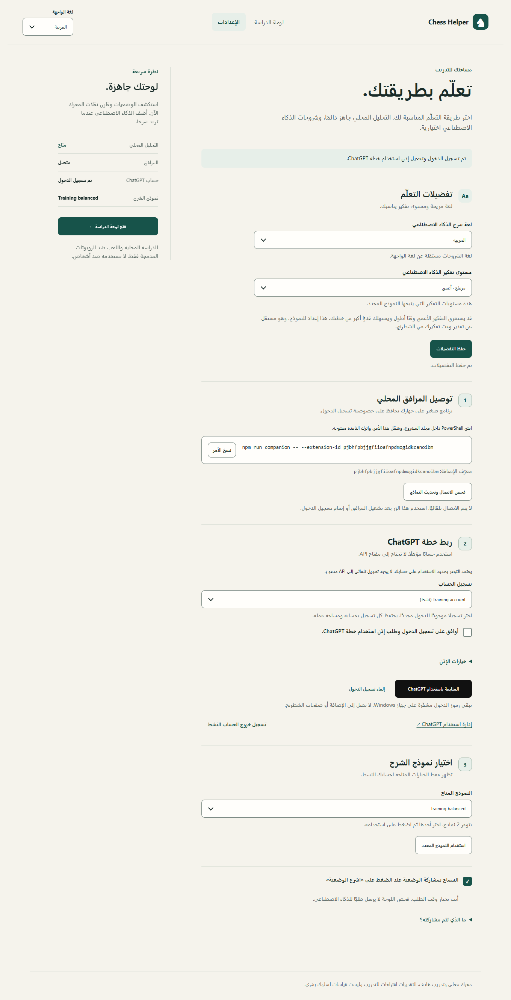

# مساعد التدريب على الشطرنج

حلّل الموقف بمحرك Stockfish على جهازك، وقارن بين ثلاث نقلات كحد أقصى، ثم اطلب شرحًا مختصرًا عند الحاجة باستخدام خطة ChatGPT الخاصة بك.

[English](../README.md) · [إعداد Windows بالتفصيل](../WINDOWS-SETUP.md) · [إعداد المشروع بواسطة وكيل برمجي](AI-AGENT-SETUP.md) · [الخصوصية](../PRIVACY.md) · [نتائج الاختبارات](../TEST-RESULTS.md)

المستودع: [zackmsa777-a11y/chess-helper-training](https://github.com/zackmsa777-a11y/chess-helper-training).

الأداة مخصصة للدراسة والتحليل والتدريب ضد الروبوتات المدمجة فقط. **لا تستخدمها ضد أشخاص.** اكتشاف نوع الصفحة لا يضمن أن الخصم روبوت.

## ابدأ دون تسجيل دخول

1. من صفحة المستودع في GitHub، اختر **Code → Download ZIP**، ثم فك الضغط في مجلد دائم.
2. افتح `chrome://extensions` في Chrome وفعّل **Developer mode — وضع المطوّر**.
3. اضغط **Load unpacked — تحميل إضافة غير مضغوطة** واختر مجلد **`extension`** الموجود داخل المشروع، وليس ملف ZIP أو المجلد الرئيسي.
4. افتح **Details → Extension options — التفاصيل ← خيارات الإضافة**، ثم اضغط **Open study board — فتح لوحة الدراسة**.

يعمل تحليل Stockfish محليًا دون حساب أو مفتاح API أو تشغيل التطبيق المرافق. يتطلب البناء المرفق Chrome أو Edge بالإصدار **120 أو أحدث**.

اختر قطعة ثم مربعًا مميزًا لنقلها بنفسك. استخدم **تراجع عن نقلة** أو **اقلب اللوحة** أو **وضع البداية**. افتح **أدوات الوضعية** لإدخال FEN والضغط على **حمّل الوضعية**، أو لاختيار قطعة الترقية قبل ترقية بيدق. لا تضيف الأداة لعبًا تلقائيًا.

## كيف تقرأ النتائج؟

- **تقييم المحرك:** الإشارة الموجبة تعني أفضلية للأبيض، والسالبة أفضلية للأسود. تقييمات المات منفصلة عن قيمة البيادق.
- **النقلات المرشحة:** تظهر ثلاثة نقلات قانونية كحد أقصى. اختر واحدة لإظهار سهم واحد على اللوحة.
- **التعقيد ووقت التفكير:** تقديرات تعليمية تعتمد على الموقف وإعداداتك؛ ليست قياسات لسلوك لاعبين حقيقيين.
- **أوزان الاختيار المحاكاة:** مقارنة تقديرية بين النقلات المعروضة فقط، وليست نسبًا إحصائية مأخوذة من مباريات البشر.
- **ميزانية تفكيرك:** الوقت الذي تريد تخصيصه لدراسة الموقف بنفسك.
- **مستوى تفكير الذكاء الاصطناعي:** مستوى الاستدلال الذي يدعمه النموذج المختار. هذا إعداد منفصل عن وقت تدريبك، ولا يضمن زمن استجابة محددًا.

## اللغة وسهولة الاستخدام

من قائمة **لغة الواجهة** أعلى صفحة الدراسة أو الإعدادات، اختر الإنجليزية أو العربية. يتغير العرض فورًا، وتدعم الواجهة العربية اتجاه القراءة من اليمين إلى اليسار. لغة شرح الذكاء الاصطناعي إعداد مستقل: يمكنك مثلًا إبقاء الواجهة بالإنجليزية وطلب الشرح بالعربية.

في **تفضيلات التعلّم**، اختر **لغة شرح الذكاء الاصطناعي** و**مستوى تفكير الذكاء الاصطناعي**، ثم اضغط **حفظ التفضيلات** وانتظر رسالة **تم حفظ التفضيلات.** تغيير لغة الواجهة وحده لا يغيّر لغة الشرح.



## إضافة شرح ChatGPT اختياريًا

تحتاج إلى Windows 10/11 وإصدار معتمد ومثبت من **Node.js 22.15 أو أحدث** مع npm. التطبيق المرافق يحفظ رموز تسجيل الدخول مشفّرة على جهازك ولا يرسلها إلى الإضافة أو صفحة الشطرنج.

افتح PowerShell داخل المجلد الرئيسي للمشروع، حيث يوجد `package.json`، ثم نفّذ:

```powershell
.\scripts\setup.ps1 -InstallDependencies
```

يحضّر هذا الأمر الاعتماديات المثبتة في ملف القفل ويشغّل الاختبارات والبناء. لا يثبت Node.js، ولا يفتح حسابًا أو يسجّل الدخول.

انسخ معرّف الإضافة المكوّن من 32 حرفًا من صفحة إعداداتها. استبدل النص التوضيحي أدناه بالمعرّف الفعلي:

```powershell
.\scripts\start-companion.ps1 -ExtensionId YOUR_32_LETTER_EXTENSION_ID
```

اترك النافذة مفتوحة، ثم:

1. عد إلى **الإعدادات** واضغط **فحص الاتصال وتحديث النماذج**. لا يتم الاتصال تلقائيًا عند فتح الصفحة.
2. حدّد موافقتك واضغط **Continue with ChatGPT — المتابعة باستخدام ChatGPT**.
3. راجع صفحة التفويض الرسمية بنفسك ووافق أو ارفض.
4. عد إلى الإضافة واضغط **فحص الاتصال وتحديث النماذج**. اختر **النموذج المتاح** ثم اضغط **استخدام النموذج المحدد**.
5. في **تفضيلات التعلّم**، اختر لغة الشرح. اترك **مستوى تفكير الذكاء الاصطناعي** على **إعداد النموذج الافتراضي (موصى به)** أو اختر مستوى تدعمه قائمة ذلك النموذج فعلًا. اضغط **حفظ التفضيلات**.
6. فعّل **السماح بمشاركة الوضعية عند الضغط على «اشرح الوضعية»**. افتح لوحة التدريب وأكّد أنك في تحليل محلي أو تلعب ضد روبوت مدمج، ثم اضغط **Explain position — اشرح الوضعية**.

عند اختيار نموذج مختلف، يعود مستوى التفكير إلى الإعداد الافتراضي. يمكنك بعدها اختيار مستوى يدعمه النموذج الجديد وحفظ التفضيلات مجددًا.

القائمة تعتمد على حسابك؛ لا تفترض الأداة توفر Astra أو أي نموذج بعينه. تستخدم الطلبات الصريحة خطة ChatGPT المؤهلة، ولا يوجد انتقال تلقائي إلى فوترة API أو مفتاح مدفوع. راجع رابط إدارة الاستخدام لمعرفة حدود الحساب وإعدادات الرصيد لدى المزود. يبقى التحليل المحلي متاحًا إذا تعذر شرح الذكاء الاصطناعي.

إذا منعت سياسة PowerShell تشغيل ملف، **لا تغيّر السياسة ولا تتجاوزها**. توضح [تعليمات Windows](../WINDOWS-SETUP.md) الأوامر اليدوية البديلة؛ وقد يحتاج مساعد التخزين المشفّر إلى آلية تشغيل أو توقيع تعتمدها جهتك.

## ما الذي يُرسل؟

عند ضغط زر الشرح، تُرسل بيانات شطرنج محددة فقط: FEN، والجانب الذي عليه الدور، ونقلات مرشحة قانونية، وتقييمات المحرك وعمق البحث، وخطوط لعب قصيرة، وإعدادات التدريب المختارة. لا تُرسل أسماء المستخدمين أو ملفات الارتباط أو عنوان الصفحة أو محتواها غير المتعلق بالموقف.

تُرفض النقلات المختلقة وHTML غير الآمن والنتائج غير الصالحة. إذا تغيّر الموقف، تُهمل الاستجابة القديمة. قد يخطئ النموذج في الشرح رغم اجتياز هذه الفحوص؛ راجع [الحدود الأمنية والمنهجية](../SECURITY.md).

## التحديث وحل المشكلات

- بعد تحديث الإضافة: اضغط زر إعادة التحميل في صفحة إضافات Chrome، ثم أعد فتح لوحة الدراسة أو حدّث صفحة الشطرنج.
- بعد تحديث التطبيق المرافق: أوقفه بـ **Ctrl+C** ثم شغّله مجددًا من المصدر المحدّث. لا تحتاج عادةً إلى تسجيل دخول جديد.
- إذا ظهر أن التطبيق المرافق غير متصل: أبقِ نافذته مفتوحة وتأكد من مطابقة معرّف الإضافة.
- إذا لم تظهر خيارات تفكير إضافية: استخدم الافتراضي. لا تُعرض خيارات لم يرجعها النموذج المختار.
- إذا لم تُحفظ لغة الشرح أو مستوى التفكير: اضغط **حفظ التفضيلات**. لغة الواجهة وحدها تُحفظ فور اختيارها.
- إذا كانت النقلة أو حقوق التبييت غير صحيحة في صفحة موقع: صحّح FEN في لوحة الدراسة المحلية؛ شكل اللوحة لا يكشف تاريخ المباراة كاملًا.

لإعداد المشروع بواسطة وكيل برمجي، أعطه المستودع والنص الجاهز في [دليل الوكيل](AI-AGENT-SETUP.md). دعه يكمل الفحص والبناء والاختبارات الوهمية أولًا، وتولَّ بنفسك الموافقة على تسجيل الدخول. لا تشارك رموز الدخول في محادثة أو مستودع عام.

## المصدر والترخيص

بُني المشروع على [chess-helper-chrome-extension](https://github.com/dzejson91/chess-helper-chrome-extension) من تطوير **Krystian Jasnos**، انطلاقًا من الالتزام `01b990b9424ac0eef905376b40d14faf8dd076c0`. حُفظت نسبته وإشعارات المكونات الأصلية. الترخيص **GPL-3.0-or-later**؛ راجع [LICENSE](../LICENSE) و[إشعارات المكونات الخارجية](../THIRD-PARTY-NOTICES.txt).

هذا المشروع غير تابع لـ Chess.com أو Lichess أو Stockfish أو OpenAI. تُفصل الاختبارات الوهمية عن التحقق الحقيقي في [تقرير الاختبارات](../TEST-RESULTS.md)؛ لا تُعد الاختبارات الوهمية دليلًا على عمل جميع الحسابات أو صفحات المواقع الحالية.
